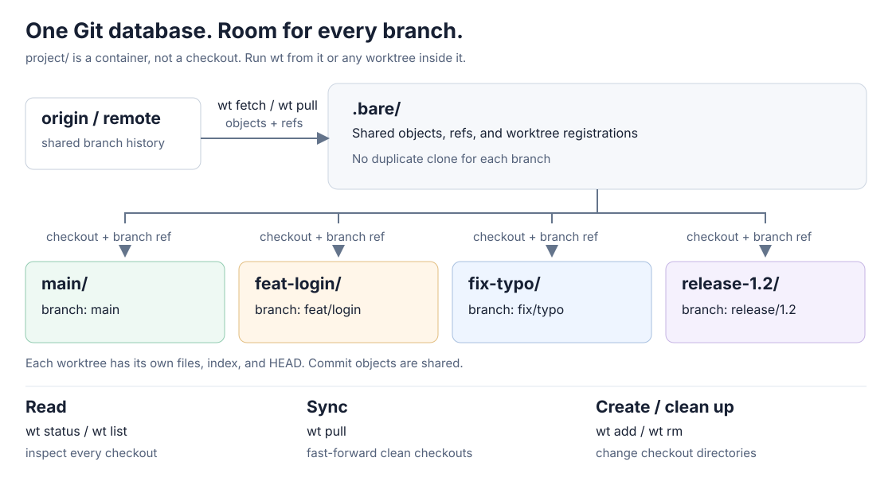

# wtree

See every worktree's status, sync clean branches, and create or remove worktrees from one bare clone.

[](https://crates.io/crates/kkamji-wtree)
[](https://github.com/KKamJi98/wtree/actions/workflows/ci.yml)
[](https://github.com/KKamJi98/wtree/blob/main/LICENSE)


[Watch the MP4](https://raw.githubusercontent.com/KKamJi98/wtree/main/docs/demo/wtree.mp4) - [Reproduce the demo](docs/demo/README.md)

## Why wtree?

Keep a feature, a bug fix, and a release checked out at the same time. Git
already supports that. `wt` handles the part you repeat across all of them.

| Without wt | With wt |
| --- | --- |
| Visit each directory to check changes and upstream state | `wt status`: one table with clean/dirty and ahead/behind |
| Fetch, then update each checkout separately | `wt pull`: fetch once, then sync worktrees in parallel |
| Track checkout paths and type `git worktree` commands | `wt add` / `wt rm`: manage them from the container or a worktree |

No stash-and-switch loop. No separate clone for each branch. `wt` calls your
installed Git, so your Git remotes, authentication, and configuration still apply.

## Installation

### Homebrew (macOS and Linux)

```bash
brew install KKamJi98/tap/wtree
```

### Cargo

```bash
cargo install --locked kkamji-wtree
```

### Prebuilt binaries

Download an archive for your platform from
[GitHub Releases](https://github.com/KKamJi98/wtree/releases/latest), extract it,
and put `wt` (or `wt.exe`) on `PATH`.

| Platform | Architectures |
| --- | --- |
| macOS | Apple Silicon (aarch64), Intel (x86_64) |
| Linux | x86_64, aarch64 (static musl) |
| Windows | x86_64 (MSVC) |

Releases include `SHA256SUMS`, per-archive checksums, and build provenance.
Verify an archive with `gh attestation verify <archive> --repo KKamJi98/wtree`.
On Windows, read the [`wt` name conflicts](#wt-name-conflicts) below first.

The **binary** is `wt`, the **Homebrew formula** is `wtree`, and the **crate** is
`kkamji-wtree`. Runtime requirement: Git on `PATH` (Git 2.15+; 2.38+ for the
squash/rebase-merge checks used during branch cleanup).

<details>
<summary>Moving from the Python version (1.x)</summary>

The Rust binary replaces the Python installation. PyPI 1.2.2 remains available;
new releases are distributed through Homebrew, crates.io, and GitHub Releases.

```bash
uv tool uninstall wtree
brew install KKamJi98/tap/wtree
# Or: cargo install --locked kkamji-wtree
```

Run `command -v wt` and `wt --version` to check that an old shim is not taking
precedence on `PATH`. Completion no longer uses argcomplete; regenerate it as
shown in [Shell completion](#shell-completion).

The commands remain familiar, but 2.0 fixes some 1.x behavior. See the
[migration notes](docs/rust-migration.md) for those differences. To return to
Python 1.2.2, first remove the Rust installation, then run
`uv tool install wtree==1.2.2`.

</details>

## Quick start

Create the layout once (replace the example URL with your repository):

```bash
wt init git@github.com:example/project.git project
cd project
# Optional: bring existing remote branches along at init time:
# wt init git@github.com:example/project.git project -w staging,develop
```

The following four examples are **actual wt 2.0.1 output from the demo's fake
repository**. `/demo` is a disposable environment; no real remote is contacted.

### 1. See all worktrees at once

```bash
wt status
```

```text
Bare repo: /demo/project/.bare


STATUS   BRANCH      SYNC           UPSTREAM           PATH
-------- ----------- -------------- ------------------ ------------------------------
DIRTY    feat/login  ↑1             origin/feat/login  /demo/project/feat-login
CLEAN    fix/typo    ↓1             origin/fix/typo    /demo/project/fix-typo
CLEAN    main        ↓1             origin/main        /demo/project/main
CLEAN    release/1.2 =              origin/release/1.2 /demo/project/release-1.2

Summary: total=4 clean=3 dirty=1
```

Ahead/behind counts use the last fetched remote-tracking refs. Run `wt fetch`
first when you need fresh counts. `status` returns **2** when any worktree is
dirty; that does not mean the table failed to load.

### 2. Sync clean worktrees, leave unfinished work alone

```bash
wt pull
```

```text
Bare repo: /demo/project/.bare

Step 1: Fetch
Fetching from bare repo: /demo/project/.bare
OK fetch --all --prune completed

Step 2: Sync worktrees

==> feat/login (feat-login)
  SKIP dirty working tree

==> fix/typo (fix-typo)
  OK fast-forwarded

==> main (main)
  OK fast-forwarded

==> release/1.2 (release-1.2)
  OK already up to date

Summary: ok=3 skip=1 fail=0
```

Here two branches fast-forward, one is already current, and the dirty worktree
is skipped. Exit code **2** records the skip. Each checkout follows its configured
upstream, not necessarily `origin`. Rebase is opt-in: `wt pull --rebase`.

### 3. Open another branch without leaving your current one

```bash
wt add feat/search -c
```

```text
Bare repo: /demo/project/.bare

Adding worktree for branch: feat/search
  Path: /demo/project/feat-search

OK created worktree at /demo/project/feat-search

Note: New branch created. To push and set upstream:
  cd /demo/project/feat-search
  git push -u origin feat/search
```

Use `wt add feat/search -c --base main` to choose a base, or `wt add staging`
for an existing branch. Slashes in branch names become hyphens in default
directory names. In a regular (non-bare) clone, supply a path explicitly:
`wt add feat/search ../search -c`.

### 4. Remove a checkout, keep its branch

```bash
wt rm feat/search -y
```

```text
Bare repo: /demo/project/.bare

Matched worktrees: 1
  feat/search                     /demo/project/feat-search

Removing worktree: feat/search
  Path: /demo/project/feat-search
  OK removed worktree

Summary: ok=1 skip=0 kept=0 fail=0
```

Without `-y`, removal asks for confirmation. Start batch cleanup with a preview:
`wt rm --match 'fix/*' --dry-run`. Branch deletion requires `-b`; remote branch
deletion also requires `--remote`. Read the warning below before using either.

## How it works



`wt init` creates a container with `.bare/` and a checkout for the default
branch. Extra worktrees sit beside it. The container itself has no `.git` file
or directory. `wt` discovers the shared Git directory from inside a worktree,
or finds `.bare` when run from the container.

- `status` probes worktrees concurrently; `list` reads their registrations.
- `fetch` runs `git fetch --all --prune` in the shared repository.
- `pull` fetches, then updates worktrees concurrently with fast-forward-only
  merges by default. Its output is printed in stable worktree order.
- `add` creates a checkout and registers it; `rm` removes the checkout and its
  registration. Neither deletes a branch unless you request that separately.

## Command reference

Run `wt --help` or `wt <command> --help` for the built-in reference.

| Command | Alias | Options and behavior |
| --- | --- | --- |
| `wt init <repo-url> [path]` | - | `-w, --worktrees <branches>`: comma-separated existing branches |
| `wt add <branch> [path]` | `a` | `-c, --create`; `-b, --base <base>` |
| `wt remove [identifier]...` | `rm` | Remove checkouts; retain branches by default. Options below. |
| `wt status` | `st` | `--json`: clean/dirty, sync, upstream, detached state |
| `wt fetch` | `f` | Fetch all remotes and prune remote-tracking refs |
| `wt pull` | `p` | `-r, --rebase`: rebase instead of fast-forward-only merge |
| `wt list` | `ls` | `--json`: registered worktrees, paths, commits, detached state |
| `wt upstream` | `up` | Set missing upstreams to `origin/<branch>` |
| `wt prune` | - | `--dry-run`: preview stale worktree registration cleanup |

Every command supports `-h, --help`. The top level also supports
`-V, --version`. There is no `wt help` subcommand.

### Removal options

| Option | Meaning |
| --- | --- |
| `-m, --match <glob>` | Match branch, directory name, or full path; repeatable. Quote globs. |
| `--dry-run` | Preview matches and branch cleanup without removal |
| `-f, --force` | Allow dirty checkout removal; with `-b`, force local branch deletion |
| `-b, --branch` | Also delete the local branch after removing the checkout |
| `--remote` | Also delete the remote branch; requires `-b` |
| `-y, --yes` | Skip the confirmation prompt, not ambiguity checks |
| `--all-matches` | Remove every worktree an identifier matches |

Identifiers resolve by exact branch/path, directory name, then whole trailing
path components, not partial words. Ambiguous matches stop even with `-y`;
use an explicit path or `--all-matches`.

### JSON and exit codes

`wt status --json` emits one JSON document on stdout, without a text header.
For example, list dirty worktrees with jq:

```bash
wt status --json | jq '.worktrees[] | select(.status == "dirty") | .path'
```

| Code | Meaning |
| --- | --- |
| `0` | Requested work succeeded |
| `1` | Error or dead end: no worktrees, no match, cancellation, invalid operation |
| `2` | Partial result: skip, kept branch, failure, or an unmatched identifier; also dirty `status` |

Argument parsing errors also return `2`. `Error:` messages go to stderr;
progress, results, and summaries go to stdout. In scripts with `set -e`, handle
`2` explicitly when a dirty status or skipped checkout is expected.

## Limits and safety

### Sync is conservative, not automatic conflict resolution

- `wt pull` skips dirty worktrees (including untracked files), detached HEADs,
  and branches without usable upstreams. A failed status probe counts as dirty.
- Diverged histories fail the default fast-forward-only update rather than
  creating a merge. Local commits that are simply ahead need no update.
- `--rebase` can rewrite local commits. A conflict triggers `git rebase --abort`.
- Network commands have no built-in timeout. Git credential and passphrase
  prompts may still need input.

### Branch deletion is not proof of a merge

> **Warning: `wt rm <branch> -b --remote` can delete both the local and remote
> branch even if it has never been merged into `main`.** Git may allow local
> branch deletion when its commits are already in that branch's upstream. The
> remote branch can then be deleted too. Do not treat `-b` as a "merged only"
> filter, and do not use `-f` unless you intend to discard work.

Use `--dry-run` to preview checkout matches, but **do not rely on its branch
safety prediction**: even with fresh refs, `--dry-run -b --remote` can say a
pushed-but-unmerged branch will be kept while the actual command deletes both
copies. Fetching does not fix this mismatch. Inspect commits and merge state
independently, and omit `-b --remote` when you only want to remove a checkout.
If actual removal keeps a local branch (`WARN branch kept`, exit 2), it skips
the remote deletion too.

### Initialization cleanup has a known gap

A non-zero clone or default-worktree creation failure triggers cleanup of what
`wt init` created. A failed fetch can instead be ignored; failures creating
additional worktrees produce warnings and retain the setup. Initialization can
therefore return 0 with an incomplete setup. Read the output and check which
worktrees exist, rather than relying on the exit code alone.

If Git terminates unexpectedly after cloning (for example, invalid UTF-8 output
or a disappearing working directory), `wt init` can also leave the new `.bare`
behind. Inspect that directory before retrying; do not assume it was removed.

### `wt` name conflicts

- Homebrew core's **worktrunk** and **wiredtiger** also install `wt`. The `wtree`
  formula declares conflicts, so Homebrew refuses side-by-side installation.
- The crates **wtree** and **worktrunk** also provide `wt`. Cargo refuses to
  overwrite another crate's binary.
- Windows Terminal uses the **`wt.exe` App Execution Alias**. Disable that alias
  in Settings > Apps > Advanced app settings > App execution aliases, or call
  this tool's `wt.exe` by its full path. Native Windows installation was not
  manually exercised for this README; the release includes an MSVC build.

## Shell completion

Homebrew installs bash, zsh, and fish completions. For a Cargo or archive install:

```bash
# zsh: add this directory to fpath before compinit in ~/.zshrc
mkdir -p ~/.zfunc
COMPLETE=zsh wt > ~/.zfunc/_wt
# In ~/.zshrc:
# fpath=(~/.zfunc $fpath)
# autoload -Uz compinit && compinit

# bash: add this to ~/.bashrc
source <(COMPLETE=bash wt)

# fish: add this to ~/.config/fish/config.fish
COMPLETE=fish wt | source
```

`wt rm <Tab>` offers existing worktree directories. Branch-value completion
uses case-insensitive substring matching; zsh's own matcher configuration can
further filter the candidates. Subcommands and options use prefix matching.
Zsh completion works on the **first Tab** since 2.0.1; regenerate an older `_wt`
if it still only registers on the first press. Completion lists full subcommand
names, not aliases, and shows long options for an empty word (short options
appear after typing `-`).

There is no wtree-specific config file. Layout, remotes, and upstreams come from Git.

## Companion tools

- **[wtree](https://github.com/KKamJi98/wtree)** (`wt`): manage many git worktrees from one bare clone - create, sync, and clean them up.
- **[awspick](https://github.com/KKamJi98/aws-profile-pick)**: pick an AWS profile from a grouped, filterable list.
- **[prjump](https://github.com/KKamJi98/prjump)** (`prj`): jump from the current branch to the new pull request page on GitHub or Bitbucket Cloud.
- **[ssh-connector](https://github.com/KKamJi98/ssh-connector)**: pick a host from your `~/.ssh/config`, grouped, and connect.

## Contributing

Bug reports and focused pull requests are welcome. Keep CLI behavior covered by
tests, and run these checks from a checkout:

```bash
cargo fmt --check
cargo clippy --all-targets --locked -- -D warnings
cargo test --locked
# Output parity with Python 1.2.2 (requires uv):
cargo build --locked && python3 scripts/golden.py check --wt target/debug/wt
```

See [the roadmap](docs/ROADMAP.md), [Rust migration evidence](docs/rust-migration.md),
and [demo reproduction instructions](docs/demo/README.md). To install your local
build, use `cargo install --locked --path .`.

## License

[MIT](https://github.com/KKamJi98/wtree/blob/main/LICENSE).
